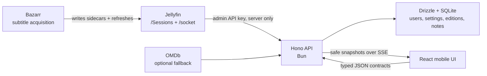

# Introspect

Introspect is a mobile-first second-screen journal for movies and shows. It follows a real Jellyfin playback session, mirrors play/pause/seek state, rolls the selected subtitle track past the playhead, and anchors private notes to the exact second that inspired them.

The repository is a Bun workspace:

- `apps/web` — React, Vite, TanStack Router, TanStack Query, Mantine
- `apps/api` — Bun, Hono, Drizzle, Better Auth, SQLite
- `packages/contracts` — shared Zod contracts and inferred TypeScript types

## What works

- Backend-only Jellyfin API-key authentication
- Jellyfin WebSocket session subscription with REST polling fallback
- Automatic play, pause, seek, item, device, and media-source synchronization
- Local sub-second playhead interpolation between Jellyfin snapshots
- Active or preferred text subtitle stream fetched as Jellyfin JSON, with WebVTT fallback
- Timed note creation, editing, deletion, color, and live highlighting
- Separate timelines and runtime overrides for theatrical/director/extended media sources
- Local single-user prototype mode by default, with optional Better Auth accounts
- Bazarr, Jellyfin, and OMDb connection status
- Responsive live, library, settings, and authentication screens
- SQLite migration, Dockerfiles, and Compose deployment

## Architecture



Jellyfin is deliberately authoritative for playback, selected media source, file duration, and subtitle delivery. Bazarr is the acquisition layer: it finds/writes sidecar subtitles and tells Jellyfin to refresh. This is more reliable than trying to join Jellyfin item IDs to Bazarr's Sonarr/Radarr IDs during playback.

## Local setup

Requirements: Bun 1.3 or later and a reachable Jellyfin server.

```bash
cp .env.example .env
bun install
bun run db:migrate
bun dev
```

Open `http://localhost:5173`, start a title on Jellyfin, then choose that user/device under **Settings → Session to follow**. The prototype defaults to `APP_AUTH_ENABLED=false`, so there is no Introspect login screen. The API listens on `http://localhost:3001`; Vite proxies `/api` during development.

If you enable Introspect accounts, generate a production auth secret with, for example:

```bash
openssl rand -base64 32
```

### Required Jellyfin values

```dotenv
JELLYFIN_URL=http://jellyfin:8096
JELLYFIN_API_KEY=your-dashboard-api-key
JELLYFIN_USER_ID=your-jellyfin-user-id
```

Create a key in Jellyfin's dashboard under API Keys. `JELLYFIN_USER_ID` is strongly recommended on shared servers: it prevents an app account from pairing with a different Jellyfin user's session. If omitted, a trusted app user can pair their user/device in Settings; identity, title, and position are redacted until that first pairing. The server address must be reachable from the API container, not necessarily from the phone.

### Two separate authentication layers

Jellyfin never uses the Introspect login form. The Hono backend authenticates to Jellyfin only with `JELLYFIN_API_KEY`, which remains server-side.

Introspect's own Better Auth accounts are optional:

```dotenv
APP_AUTH_ENABLED=false  # default prototype mode; one local profile, no login screen
```

Set `APP_AUTH_ENABLED=true` only when you want separate Introspect users and private note collections. Then create an Introspect account with an email/password chosen specifically for this app; these are not Jellyfin credentials.

### Optional Bazarr values

```dotenv
BAZARR_URL=http://bazarr:6767
BAZARR_API_KEY=your-bazarr-api-key
```

In Bazarr, enable its Jellyfin integration and the movie/series metadata-refresh options. Bazarr still requires Sonarr/Radarr. Introspect does not send the Bazarr global key to the browser and does not expose Bazarr's raw file-path subtitle endpoint.

### Optional OMDb value

```dotenv
OMDB_API_KEY=your-omdb-key
```

OMDb exposes one rounded, title-level runtime, not the runtime of a particular cut. Introspect never lets it silently replace the duration reported for the selected Jellyfin file.

### Defaults

| Setting                           | Default                        |
| --------------------------------- | ------------------------------ |
| Subtitle language                 | English (`eng`)                |
| Note appears before its timestamp | 2 seconds                      |
| Note remains prominent afterward  | 12 seconds                     |
| Note color                        | Amber                          |
| Jellyfin REST reconciliation      | 10 seconds                     |
| Subtitle cache                    | 6 hours per item/source/stream |

All can be adjusted in the UI except the server polling/cache settings.

## Docker Compose

Create `.env`, set at least `BETTER_AUTH_SECRET`, `JELLYFIN_URL`, and `JELLYFIN_API_KEY`, then run:

```bash
docker compose up --build
```

The UI is available on `http://localhost:8080` by default. For a reverse proxy, set `PUBLIC_URL=https://notes.example.com`. Keep the API, Jellyfin, and Bazarr on a private network and terminate TLS at the reverse proxy.

Authentication is disabled by default in Compose. If you opt in with `APP_AUTH_ENABLED=true`, set `ALLOW_SIGN_UP=true` for the first startup, create the accounts you need, then change it to `false` and restart the API. Production defaults to closed registration when the variable is omitted.

## Why SQLite

SQLite is the default because this is normally one self-hosted API process with modest concurrent writes. WAL mode is enabled, foreign keys are enforced, and backup/restore is a single volume. It avoids running PostgreSQL solely for a personal companion app.

Use PostgreSQL when running multiple API replicas, accepting heavy multi-user write traffic, or when operational policy already provides managed Postgres. The application keeps contracts and integration services independent of storage, but the included Drizzle schema/adapter currently targets SQLite.

## Jellyfin synchronization details

The implementation follows the current Jellyfin protocol rather than scraping the web client:

1. The backend opens `{JELLYFIN_URL}/socket` with a modern `MediaBrowser` Authorization header.
2. It sends `{"MessageType":"SessionsStart","Data":"0,1000"}`.
3. It immediately calls `GET /Sessions`; `SessionsStart` does not guarantee an initial snapshot for already-paused playback.
4. Full `Sessions` WebSocket snapshots re-anchor position and play/pause state.
5. `PositionTicks / 10_000_000` becomes seconds. The browser advances from receipt time only while state is `playing`.
6. A 10-second REST reconciliation heals proxy/WebSocket interruptions.
7. Jellyfin's `ForceKeepAlive` message is answered with `KeepAlive`.

The API fetches subtitle cues from:

```text
GET /Videos/{itemId}/{mediaSourceId}/Subtitles/{streamIndex}/Stream.json?CopyTimestamps=true
```

It uses `PlayState.SubtitleStreamIndex` when that stream is text; otherwise it chooses a preferred-language text track. Bitmap PGS/VobSub/DVB subtitles cannot be turned into notes without OCR, so the UI asks for a Bazarr-provided SRT/VTT sidecar instead.

Detailed API reasoning and primary sources are in [docs/integrations.md](docs/integrations.md).

## Commands

```bash
bun dev                 # API + web dev servers
bun test                # Bun unit tests
bun run typecheck       # strict TypeScript across all workspaces
bun run build           # production API and web builds
bun run db:generate     # generate the next Drizzle migration
bun run db:migrate      # apply migrations
bun run format:check
```

## Security notes

- Jellyfin API keys are administrator-equivalent. They only exist in API environment variables and backend outbound requests.
- The React app receives an app-owned playback DTO, never a full Jellyfin session DTO containing IPs or media paths.
- Bazarr uses one global, unscoped API key. Browser access and Bazarr CORS are unnecessary and should remain disabled.
- Image and subtitle traffic is proxied by Hono; Jellyfin keys never appear in browser URLs. Routes require Better Auth when `APP_AUTH_ENABLED=true`.
- Subtitle text is stripped of markup and rendered as text.
- Runtime and note lookups are scoped to the local profile or signed-in Better Auth user.
- If the app is internet-facing, enable app authentication, use HTTPS, a strong auth secret, `ALLOW_SIGN_UP=false`, and network controls around Jellyfin/Bazarr.

## Known boundaries

- Introspect observes playback; it does not impersonate a Jellyfin player or write to `/Sessions/Playing*`.
- A client that crashes without reporting stop can remain visible until Jellyfin expires the session.
- Bazarr acquisition/search jobs are intentionally not triggered per playback event; doing so consumes provider quotas and can enqueue duplicates.
- Timelines remain separate across media sources. Introspect does not proportionally stretch timestamps between cuts because inserted/deleted scenes create nonlinear offsets.
- This version uses one configured Jellyfin server per API deployment.
