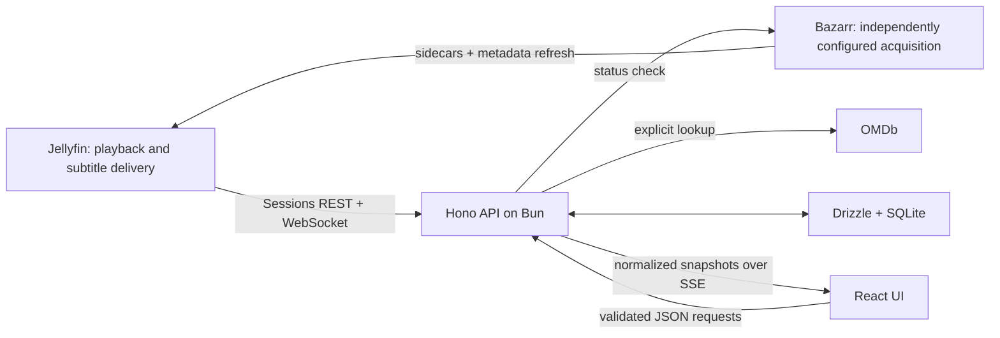

# Architecture

This map describes the repository implementation. Protocol research and its dated sources live in [integrations.md](integrations.md); setup and checks live in [development.md](development.md).

## Code map

| Location                                                                                    | Responsibility                                                                     |
| ------------------------------------------------------------------------------------------- | ---------------------------------------------------------------------------------- |
| [`apps/web/src/router.tsx`](../apps/web/src/router.tsx), [`pages/`](../apps/web/src/pages/) | Live, Library, and Settings routes; auth gating is in `components/app-layout.tsx`  |
| [`apps/web/src/api/`](../apps/web/src/api/)                                                 | Credentialed HTTP client, response validation, and Better Auth client              |
| [`apps/web/src/hooks/use-playback.ts`](../apps/web/src/hooks/use-playback.ts)               | SSE subscription, HTTP fallback, and browser clock interpolation                   |
| [`apps/api/src/index.ts`](../apps/api/src/index.ts)                                         | Migrate, ensure Local viewer, start Jellyfin sync, serve Hono, shut down           |
| [`apps/api/src/app.ts`](../apps/api/src/app.ts)                                             | Routes, app authentication, validation, image proxy, SSE, and errors               |
| [`apps/api/src/services/playback.ts`](../apps/api/src/services/playback.ts)                 | Session filtering/pairing, app snapshots, subtitle choice/cache, connection checks |
| [`apps/api/src/services/repository.ts`](../apps/api/src/services/repository.ts)             | User-scoped settings, timeline resolution, runtime updates, and note CRUD          |
| [`apps/api/src/integrations/`](../apps/api/src/integrations/)                               | Jellyfin transport/normalization, Bazarr status, and OMDb lookup                   |
| [`apps/api/src/db/`](../apps/api/src/db/), [`drizzle/`](../apps/api/drizzle/)               | SQLite connection, Drizzle schema, and migrations                                  |
| [`packages/contracts/src/index.ts`](../packages/contracts/src/index.ts)                     | Shared Zod schemas, types, validation limits, and timestamp helpers                |

## Data flow

The API is the only component that receives integration keys. It uses Jellyfin for sessions, artwork, and subtitle delivery. Bazarr only exposes a status check to Introspect; acquisition and Jellyfin refresh must be configured outside this app. OMDb lookup runs only on a user request.

The browser receives app contracts instead of raw Jellyfin session objects, media paths, or IP addresses. Subtitles are stripped of markup and rendered as text. Artwork is proxied after checking that the current app user owns a matching timeline.

## Playback and subtitle synchronization

One `JellyfinSync` instance holds raw sessions in memory for the configured server. It subscribes to `/socket` with `SessionsStart` (`0,1000`), fetches `/Sessions` after connection, and reconciles over REST at the configured interval (10 seconds by default). It answers `ForceKeepAlive`, retries the socket with backoff up to 30 seconds, and retains the last sessions when REST refresh fails. A connection badge is not a guarantee of a fresh snapshot.

The API chooses a permitted session and emits a user-specific snapshot over `/api/playback/events`, with a five-second heartbeat. The browser also fetches `/api/playback` every 15 seconds. Its 250 ms clock advances from receipt time only while playing and clamps to the stored runtime. Pause, seek, and item/source changes re-anchor the clock when snapshots arrive. Network latency makes this an approximate second screen, not frame-accurate synchronization. A crashed Jellyfin client may remain visible until Jellyfin expires it.

Subtitle discovery uses session streams, then selected-source playback info, then item metadata. Text tracks are scored by current selection, language, external/default/forced flags. JSON is preferred; a failed JSON request/parsing attempt falls back to WebVTT. Parsed cues are cached in process for six hours per item/source/stream, with at most 100 entries. There is no OCR or automatic Bazarr job dispatch. See the [protocol research](integrations.md#subtitle-delivery) for endpoint details.

## Authentication and trust

Better Auth stores app accounts/sessions in SQLite. With `APP_AUTH_ENABLED=true`, application routes require an app session; health, config, and Better Auth's own routes are outside that gate. With it disabled, application requests all use the fixed Local viewer ID. Better Auth routes remain mounted even in local mode, so `ALLOW_SIGN_UP` is a separate setting.

Notes, settings, and timelines are scoped by app user. This is separate from authorization to inspect Jellyfin users: the backend uses one privileged Jellyfin API key and pairing does not verify the viewer's Jellyfin credentials.

The normal session picker checks `JELLYFIN_USER_ID` (or the saved pairing), and hides user/title/position before an unscoped first pairing. However, `PATCH /api/settings` accepts `preferredJellyfinUserId` and `preferredDeviceId` directly, and playback filtering prefers the stored user over the environment default. Consequently, `JELLYFIN_USER_ID` is not an enforced tenant boundary against a caller making direct API requests. Deploy for trusted users; hardening this path is required before claiming isolation between untrusted Jellyfin users.

## Timeline and runtime rules

The unique timeline key is **app user + Jellyfin server key + item ID + media-source ID**. The server key is the configured Jellyfin URL with its trailing slash removed, or `demo` when no URL is configured. Changing that URL can create a new timeline identity. A missing media-source ID is stored as an empty string. Notes reference the app-owned timeline UUID; their timestamps are rounded to whole seconds and are never stretched between cuts.

Resolving a playback snapshot creates or refreshes a media row, even without a note. Settings reads can create defaults. These GET paths therefore have database side effects; use an isolated database for verification. Library returns the 100 most recently seen media rows for a user, with note counts.

Actual runtime behavior in `repository.ts` is:

- A `manual` override survives incoming playback updates and controls the displayed runtime/clamp.
- Otherwise, resolution uses `NowPlayingItem.RunTimeTicks` from the Jellyfin snapshot. The code does not separately fetch a media-source duration for runtime resolution.
- OMDb is a manual lookup-and-save action. Values saved with source `omdb` can be replaced by the next resolution, including by a missing Jellyfin duration; they are not a persistent automatic fallback.
- Clearing an override restores the last stored Jellyfin duration, or unknown. The UI's **Use automatic** action also clears the edition label.

## Storage and deployment boundaries

SQLite stores Better Auth users/accounts/sessions/verifications, preferences, observed media, edition labels, and notes. WAL, foreign keys, and a five-second busy timeout are enabled. Playback sessions and subtitle caches are in memory and are rebuilt after restart.

The existing project rationale for SQLite is one self-hosted API process with modest concurrent writes and a single persistent volume. PostgreSQL would require a schema/adapter and migration change; there is no supported database switch or multi-replica deployment in this repository.

Compose runs the API and an Nginx web container. Nginx serves the Vite build, proxies `/api`, and disables proxy buffering for SSE. Only the web port is published. The API Dockerfile runs TypeScript source with Bun, rather than the local `dist` bundle. [Operations](operations.md) owns configuration, backup, and recovery procedures.

## API reading map

The route definitions in [`app.ts`](../apps/api/src/app.ts) and payload schemas in [`contracts`](../packages/contracts/src/index.ts) are authoritative. The UI client in [`client.ts`](../apps/web/src/api/client.ts) provides concrete request examples.

| Route group                                           | Purpose                                            |
| ----------------------------------------------------- | -------------------------------------------------- |
| `/api/health`, `/api/config`, `/api/auth/*`           | Liveness, mode flags, app account/session handling |
| `/api/playback`, `/api/playback/events`               | Snapshot and SSE stream                            |
| `/api/playback/sessions`, `/api/playback/subtitles`   | Session list/selection and subtitle cues           |
| `/api/settings`, `/api/connections`                   | Preferences and service status                     |
| `/api/media`, `/api/media/:jellyfinItemId/image`      | Observed library and artwork                       |
| `/api/media/:mediaId/notes`, `/api/notes/:noteId`     | List/create and update/delete notes                |
| `/api/media/:mediaId/runtime`, `/api/metadata/lookup` | Runtime/edition changes and explicit OMDb lookup   |

Application errors use `{ "error": { "code", "message", "details"? } }`. Better Auth handles its own route responses. Frontend calls use cookies; the Jellyfin key is not an app API credential.
